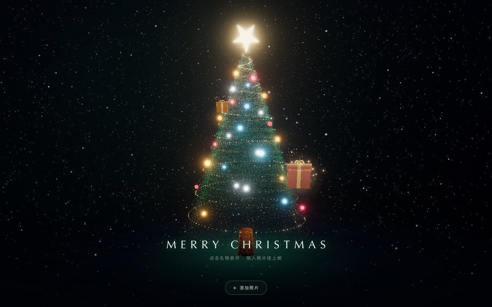
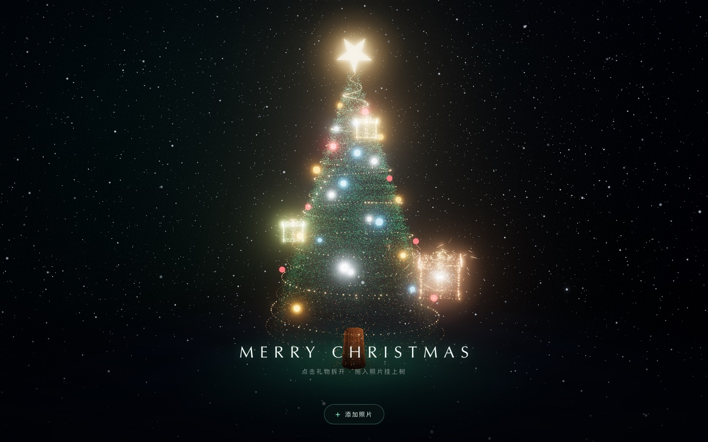
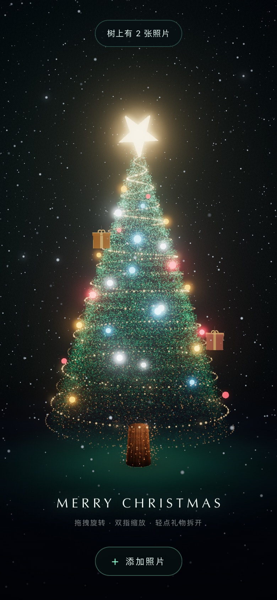

# 🎄 会发光的圣诞树

一棵完全由粒子点亮的圣诞树。它不是一段视频，而是一个可以拖拽旋转、把照片挂上树梢的实时三维场景。



<sub>悬停礼物：放大、盒盖微翘、周围洒出粒子</sub>



<sub>拆开礼物：盒盖弹开、盒内透光、粒子炸开</sub>

<p align="center">
  
</p>

## 效果

- **72,000 个粒子**沿锥面螺旋分布，越靠底部越密，树尖自然变稀
- **开场生长动画**：五条发光的丝带从树顶绕下来，把树从上到下「带亮」 → 灯串流动 → 挂饰依次亮起 → 树顶星亮起 → 文案浮现，约 5 秒
- **螺旋灯串**：一条缠绕树身的光带（26 圈），亮度波持续向下流动
- **树身有层次**：每条粒子带一个"枝层"权重（沿高度做周期起伏），层与层之间压暗、连颜色一起压，锥面的半径也跟着轻微起伏——远看才不是一块平坦的绿雾；内层的点更暗、外层的枝梢混一点冷白，像落了层薄霜
- **树上的装饰**：一条只有 4.5 圈的金丝花环（和 26 圈的紧灯串反着绕，一紧一松交叉才有层次）、几十簇"枝头霜团"、以及一批各自按不同节奏闪烁的亮点
- **挂饰**：26 颗红、金、白、冰蓝的发光球，各自以不同频率脉动；照片礼物盒也挂在其中
- **树顶星**：立体五角星 + 泛光光晕，缓慢左右摆动
- **飘雪**：远景 7,000 片细雪 + 一层更大的近景雪花（加法混合的柔光斑），带两层风偏
- **远景星空**：极慢自转，给夜色留出纵深
- **地面**：暗色雪地 + 树干接触阴影 + 树裙洒下的绿色光
- **树干**：自定义着色器伪造侧光与轮廓光，周围有缓慢上升的暖色余烬
- **后期**：泛光 + 暗角 + 细噪点

## 礼物盒：照片藏在礼物里

树上挂的不是照片，而是一个个小小的礼物盒，**固定 24 个**（树是 3D 的、会转，盒子要绕一圈才对）。

所有盒子长得一样，拆开是什么只看**有没有存过照片**：

- **存过照片**：随便点哪个盒子，都会随机飞出一张照片（连开两次不会重复同一张）
- **一张都没有**：拆开是一张祝福卡——深蓝底、金色内框、衬线体的 `Merry Christmas`，带 `?to=小明` 时上面还有一行 `To 小明`
- 盒子数量和照片数量无关：传 3 张还是传 60 张，树都是 24 个盒子

- 礼物盒本身也是**粒子拼出来的**：稀疏的盒身光点 + 更亮的棱边 + 金色丝带 + 蝴蝶结，和粒子树同一个世界
- 盒身用节日配色（红 / 金 / 蓝 / 绿 / 粉），不再取自照片
- **光尘拖尾**：每个礼物周围有一圈金色粒子，绕着盒子缓慢上升，每颗都拖一小段尾迹
- **礼物连线**：每隔两秒左右，两个离得近的礼物之间会亮起一串金色光点连成的弧线，像星座一样短暂相连
- **悬停**：礼物放大、轻轻晃动、盒盖微微翘起，光尘变亮变长，并持续洒出星火
- **挂上新照片**：照片飞到位的那一瞬，那个礼物会亮一下、扩一圈冲击波光环、再炸一簇星火——落位有"啪"的一下，不会像飘过去就没了（刷新后恢复的照片不闪）
- **点击**：盒盖弹飞、盒内透出暖光、炸开两波金色粒子并扩散一圈冲击波光环，里面的东西（照片或祝福卡）飞出来、放大到页面中间
- 关掉照片后，礼物重新合上，树回到原来的样子
- 礼物越多，盒子自动变小并沿螺旋重新排布；转到树背面的会淡出

照片在浏览器内按原比例缩到长边 1024px（不裁切，横图竖图都保持原样）后存进 IndexedDB，**不会上传到任何服务器**；清浏览器数据会一并消失。树上只保留照片的平均色用于礼物配色，不会把整张照片加载进显存。

## 手势：🤟 我爱你 / 竖大拇指 / 握拳张开

点工具栏的「手势」按钮才会申请摄像头权限，**默认是关的**：

- **🤟 我爱你**（拇指、食指、小指伸开，中指和无名指收起来）→ 树上的一部分粒子**离开树体**，在树前方汇聚成一颗**立体的爱心**：绕 Y 轴缓慢自转、微微跳动，停一会儿再飞回树上（[`js/heart3d.js`](js/heart3d.js)）
  - 起点用的是树上的真实粒子坐标，所以看起来是从树里长出来的，而不是凭空出现
  - 早先这里是"比心"（拇指食指指尖相碰），但那个手型和捏合、比划的手势都在边界上，真机上一直不稳；🤟 的四个判断维度全是"伸还是收"，和握拳、张开、竖大拇指两两互斥
- **竖大拇指**（四指收住、拇指朝上）→ 把 👍 的剪影采样成点云拼出来（轮廓亮、内部暗），不是贴 emoji
- **握拳 → 张开 → 再握拳** → 组合技：整棵树炸开成一团粒子云，再收拢成一句 `Merry Christmas`（详见下一节）
  - 这是一条**序列**手势：先把拳头稳住 0.18 秒，再张开才算第一步，单纯张开手掌、挥手、打字都不会误触
  - 张开之后有 8 秒的窗口再握一拳收尾；不握就自己散回树上
  - 收尾那一步最早用的是"拇指食指捏合"，但那个手型和其他手势几乎重合，真机上分不开，于是改成再握一拳——全程只有"拳"和"掌"两种状态
  - "手放下了"按**时间**算（1.5 秒），不是按帧数：张开→握拳本来就要经过半开状态，按帧数算会把正常速度的握拳判成走开，整段作废
- **点礼物** 仍然是看大图的正门（手势让位给组合技之后，这条路完全没变）
- 保持约 **0.1 秒**就触发，期间手的位置会出现一个**准星 + 蓄力环**，环填满即触发——所以不会"比半天没反应"
- 识别跟着摄像头每一帧走（只在画面真更新时跑模型），不再固定抽帧
- 送进模型的画面先缩到 320 宽，推理更快
- 鼠标移到「手势」按钮上、或用过手势的人再次打开页面（空闲时），会**提前把 17MB 模型加载好**，点按钮后只剩摄像头握手
- `?debug=1` 时右下角会显示实时延迟（从姿势满足条件到特效出现）
- 冷却 0.7 秒，避免连续触发刷屏
- 「预览」按钮打开左下角的摄像头小窗，能看清手在哪；默认关，选择会记住
- 再点一次「手势」立刻停止采集，摄像头指示灯熄灭

隐私：画面只在本机内存里做推理，**不上传、不落盘**。模型与 wasm（约 17MB）放在 `vendor/mediapipe/`，只有点「手势」时才动态加载，不影响首页加载速度。

手部 21 个关键点由 MediaPipe Tasks Vision 的 `HandLandmarker` 给出；🤟 判定是几条几何启发式（拇指外张度、食指与小指的伸直度、中指与无名指的蜷曲度），阈值集中写在 [`js/hand.js`](js/hand.js) 的 `THRESHOLD` 里，真机手感不对直接调数。

## 组合技：把整棵树拼成一句话

对着摄像头**先握拳、再张开**（和上一条同一个起手式）：

1. 整棵树的粒子离位、向外甩开，和挂饰的节日色、树上的照片混成一团涌动的云（散开半径按树体基准半径的 2.4 倍给，照片绕到 3.0～4.5，故意比树的范围大一截，粒子和照片才散得开）
   - 照片会从礼物里飞出来，跟着云一起翻飞
2. 在 8 秒内**再握一次拳**
   - 照片先缩成粒子——按自己的像素采样、点的颜色取自照片
   - 所有粒子一起收拢，排成 `Merry Christmas`
3. 停约 4 秒自动散回树上；也可以再握一次拳提前散开

粒子拼字用的是 `--serif` 那套字体（Optima / Palatino / Georgia）画到离屏 canvas 上，再按笔画的像素采样成点。竖屏自动换成两行。文字始终面向相机，缩放跟着机位距离走，拉到任何角度、任何距离都完整入镜。

**没有照片也能玩**——只是文字会回到树体配色的暖金，少了照片的颜色。

## 过场：圣诞老人雪橇

打开页面约 6 秒后自动播一遍，点树顶星可以再看，`?santa=1` 打开就播：

- 车里的圣诞老人：**形状来自真 3D 模型，材质还是场景里的光点**。模型是 [Storybook Santa](https://3dassets.dev/assets/christmas-storybook-storybook-santa-673e2b29)（CC0 1.0，5380 面、无贴图、262 KB），加载后按三角形面积加权撒 6000 个点，每点带面法线和部件的底色（大衣红、胡子白、扣子金）。同一个采样点出两颗：一颗铺在面上当体积（按物体空间主光调明暗）、一颗落在**掠射角**上描边，所以既有一个立得住的体积、又有一圈亮轮廓。顶点着色器里按 `aEdge` 分两条规则剔除——填充点只留朝镜头的半边，描边点只留 \`abs(dot(N, V))\` 接近 0 的那一圈。加载器和模型都走 \`import()\` 懒加载，不挡开场
  - 走过的弯路都在 git 历史里：手绘光点（形状撑不住）、按插画铺点（糊成白团）、3D 线框（侧面塌成条码）、发光丝带（太像速写）、实心 PBR 材质（形状最准，但在一片光点里像个塑料玩具）
- 雪橇、驯鹿全部由光点拼成：雪橇是侧面剪影挤出成车身后再在表面撒点，两侧轮廓更亮；驯鹿是圆点勾出的线稿（躯干、脊背、脖子、口鼻、耳朵、鹿角、短尾、项圈铃铛都在），**四条腿各有髋和膝两个关节、按横向奔跑的四拍次序落蹄**，加上躯干的俯仰和颠动，整只鹿是在跑的；两只鹿相位错开，车上坐着一个小人，车尾挂着礼物袋
- 关节动画全在顶点着色器里算：每个点带上自己的关节（`aSeg` / `aHip` / `aKnee` / `aAmp` / `aPhase`），每帧只改一个 `uTime`，CPU 不碰几何体
- 路径是一条 `CatmullRomCurve3`：从画面上方飞入 → 绕过树顶 → 从树的**背面**绕到左边 → 沿 S 形螺旋下降 → 右下角飞出画面
- 车尾拖着**最多 6 张照片**：依次放出来、上下错开成一串跟着雪橇摆动，到后半段一张张划着弧线飞到树上对应的礼物位置，落地时炸一小簇星火
- 照片都带一圈**金色发光边框**：夜空是黑的、照片本身也可能是暗的，有了这圈边，暗色照片同样一眼能找到
- 竖屏时路径会被压扁，照片同步缩小、拉开间距，不会挤成一坨
- 雪在过场期间下得更足（近景层拉满、风力加倍），结束后慢慢回到平时的细雪
- 12 秒一场；结束即释放照片贴图与粒子，不留残留对象
- 竖屏时整条路径会按画面宽度自动压扁，不会飞出画外
- `prefers-reduced-motion` 下不自动播（点星星仍然可以手动看）

## 背景音乐：现场合成的《Jingle Bells》

工具栏的「音乐」按钮，**默认是关的**，点了才出声：

- 整段音乐是 Web Audio 现场合成，**不引入任何音频文件**：正弦波打底 + 高八度三角波做泛音 + 低通削高频，短促的指数衰减，出来是八音盒的音色
- 曲目是 1857 年的《Jingle Bells》（公有领域），用 `[音高, 起始拍, 持续拍]` 的数组写死，换曲子只改这个数组
- 调度用 `AudioContext.currentTime` 提前排音符，`setInterval` 只负责叫醒，所以页面掉帧也不会让节奏抖
- 音量从 0 淡入、关闭时淡出；切到别的标签页会自动停，切回来接着放
- 浏览器要求 AudioContext 必须在用户手势里创建，所以**打开页面时不会创建任何音频上下文**

## 交互

| 操作 | 效果 |
| --- | --- |
| 拖拽 | 旋转视角 |
| 滚轮 / 双指 | 缩放 |
| 移动鼠标 | 树随指针轻微偏转 |
| 点击礼物 | 拆开礼物：有照片就是照片，没有就是祝福卡，飞到页面中间 |
| 点击空白处 | 在点击处撒出一把金色星火 |
| 对着摄像头比 🤟 / 竖大拇指 | 粒子从树里飞出聚成 3D 爱心 / 金色大拇指（要先点「手势」） |
| 对着摄像头握拳再张开 | 整棵树炸开成一团粒子云（要先点「手势」） |
| 接着再握一拳 | 粒子云拼成 `Merry Christmas` |
| 点「音乐」 | 播放 / 暂停现场合成的《Jingle Bells》 |
| 点树顶星 | 重播一遍圣诞老人雪橇过场 |
| 悬停礼物 | 礼物放大、盒盖微翘、洒出粒子 |
| 链接加 `?to=小明` | 底部文案变成 `To 小明` 的定制问候 |

## 本地运行

没有构建步骤，任何静态服务器都能跑：

```bash
python3 -m http.server 8123
```

然后打开 <http://127.0.0.1:8123>。

> 直接双击 `index.html` 用 `file://` 打开会失败：ES module 与 `importmap` 在 `file://` 下受浏览器限制，必须走 HTTP。

## 目录结构

```
index.html          页面骨架、importmap、文字层
css/style.css       布局、加载态、排版
js/
  main.js           场景装配、开场时序、相机、交互、自动降级
  config.js         几何尺寸、配色、画质档位、相机 —— 调参入口
  background.js     天幕渐变与星云
  tree.js           树体粒子与螺旋灯串（着色器）
  tree-decor.js     树上的装饰：金丝花环、枝头霜团、闪烁亮点
  ribbons.js        开场丝带：从上往下绕着树扫过，把树「带亮」
  platform.js       树站的发光圆台：台面暗、台沿亮，台沿上有一道跑动的光
  gifts.js          台面上堆的粒子礼物盒（几摊 + 几摞叠着的）
  trunk.js          树干：整根由粒子堆出来的圆柱 + 上升的余烬
  ornaments.js      发光球挂饰（装饰用）
  photo-ornaments.js 照片挂饰：动态布点、朝向、淡出、拾取
  photos.js         照片压缩与 IndexedDB 存取
  hand.js           摄像头手势：🤟 / 大拇指 / 握拳张开判定、状态机、摄像头生命周期
  gesture-fx.js     手势特效：准星、蓄力环、大拇指、掌心脉冲（Canvas 2D 叠加层）
  heart3d.js        🤟 的 3D 粒子爱心：从树上的位置起飞、汇聚、自转、飞回
  santa.js          过场：雪橇路径、粒子雪橇与驯鹿、照片拖尾与投递
  compose.js        组合技：整棵树炸开 → 收拢成 "Merry Christmas"
  audio.js          背景音乐：Web Audio 现场合成（无音频文件）
  star.js           树顶五角星
  snow.js           飘雪（远 / 近两层，强度可调）
  sky.js            远景星空
  ground.js         地面、接触阴影、落光
  burst.js          点击星火
  textures.js       程序化生成的柔光贴图
vendor/three/       three.js r187（内嵌，含 OrbitalControls 与后期模块）
vendor/mediapipe/   手部关键点模型与 wasm（17MB，按需加载）
```

## 调参

几乎所有的视觉参数都在 [`js/config.js`](js/config.js)：

- `TREE`：树高、底半径、螺旋圈数、树干尺寸
- `PALETTE`：树体渐变、灯串、星星、挂饰、雪的颜色
- `QUALITY`：三档画质的粒子数、像素比、是否开泛光
- `CAMERA`：视角、机位、可旋转范围
- `TIMELINE`：开场动画各阶段的延迟

链接参数：

| 参数 | 作用 |
| --- | --- |
| `?to=小明` | 底部文案加一行定制称呼 |
| `?quality=high\|medium\|low` | 强制画质档位（强制后不再自动降级） |
| `?santa=1` | 打开就播一遍雪橇过场（不用等 6 秒） |
| `?roi=0` | 关掉手部 ROI 裁剪（手势识别出问题时的兜底开关） |
| `?debug=1` | 暴露 `window.__xmas`，方便自动化测试 |

## 性能与降级

- 开场：星星先亮，五条丝带从树顶绕着树往下走，扫过的地方树叶跟着亮起来（约 3.6 秒），树亮完丝带撤走，挂饰和 HUD 随后跟进
  - 丝带的带头踩的就是树的点亮边界（`1 - 1.12 × uProgress`，和 `tree.js` 里那条 `reveal` 同一个斜率），所以不会出现「丝带到了、树还没亮」
  - 每条丝带的点在顶点着色器里按「离带头多远」上色和淡出：扫过之后才亮、离带头越远越暗，形成一条有方向的拖尾；再乘一个按半径反比的系数，树底那一圈才不会白成一道横线
  - 每条丝带是**双股**的（半径和角度各错开一点），单股看着像一根电线；每股再出一颗大的暗点当外晕
  - 一成左右的点当**火星**：位置每帧抖、亮度单独闪，丝带边上才有碎光；另有一道顺着丝带往下跑的脉动
  - 位置/旋转全在着色器里算，几何体只建一次（5 条 × 1300 点 × 4）
- 首屏根据设备选择画质：桌面高、移动端中
- 运行中若连续低于 44fps，自动降档：粒子数减半、关闭泛光、像素比降到 1
- 着色器里计算粒子位置，CPU 每帧只更新几个 uniform
- 手势推理的输入缩到 320 宽（再降到 256 真机上容易丢手，退回来了）——判定用的是比例，和分辨率无关，所以阈值不用跟着改
- 手部 ROI 裁剪的代码留着，但默认关（`?roi=1` 才开）：裁剪会让"丢一帧"变多，而手势要求连续帧，真机上反而更难触发
- `?debug=1` 的右下角面板会显示单帧推理耗时和 ROI 占比

## 路线图

- [x] 开场丝带：五条双股发光的丝带从树顶绕下来把树带亮（带火星和脉动），亮完撤走
- [x] 树站的圆台：台面撒暗点、台沿两圈亮点 + 一道沿边跑的光；等树的灯光快走到根部时才浮现
- [x] 圆台上的礼物堆：二十来个粒子盒子，围着几个"堆心"聚成几摊，另有四摞是叠起来的；跟挂饰一起亮起来
- [x] 照片挂饰：上传 → 圆形成像 → 挂上树 → 点击看大图（IndexedDB 本地保存）
- [x] 摄像头手势：🤟 我爱你 → 3D 粒子爱心、竖大拇指 → 粒子拇指（MediaPipe 手部追踪）
- [x] 摄像头手势：握拳→张开 → 整棵树炸开成粒子云（组合技起手）
- [x] 过场：圣诞老人雪橇 S 形绕树，车尾拖着照片，雪加大
- [x] 背景音乐开关（Web Audio 合成，无版权素材）
- [x] 组合技：握拳张开炸开整棵树，再握一拳拼成 Merry Christmas
- [x] 手势提速：推理输入缩到 320（256 真机丢手，已退回；ROI 默认关）
- [ ] 更多彩蛋与文案模板

## 技术说明

- [three.js](https://threejs.org/) r187，构建产物内嵌仓库，不依赖 CDN
- 无打包工具，原生 ES module + `importmap`
- 树体、灯串、雪、星空、余烬、雪橇均为自定义 `ShaderMaterial`
- 雪橇路径用 `THREE.CatmullRomCurve3` 预先按弧长采样成数组，每帧只查表
- 组合技的粒子在顶点着色器里按 `uProgress` 在三组位置之间插值（树形 / 乱窜 / 文字），CPU 每帧只更新几个 uniform
- 音乐全部由 `OscillatorNode` 现场合成，可以通过 `OfflineAudioContext` 离线渲染出来验证波形
- 手势用 [MediaPipe Tasks Vision](https://ai.google.dev/edge/mediapipe/solutions/vision/hand_landmarker) 的 `HandLandmarker`，模型与 wasm 内嵌在 `vendor/mediapipe/`
- 后期使用 `UnrealBloomPass` + `OutputPass`

## 许可

代码可自由使用与修改。three.js 遵循其 MIT 许可。
